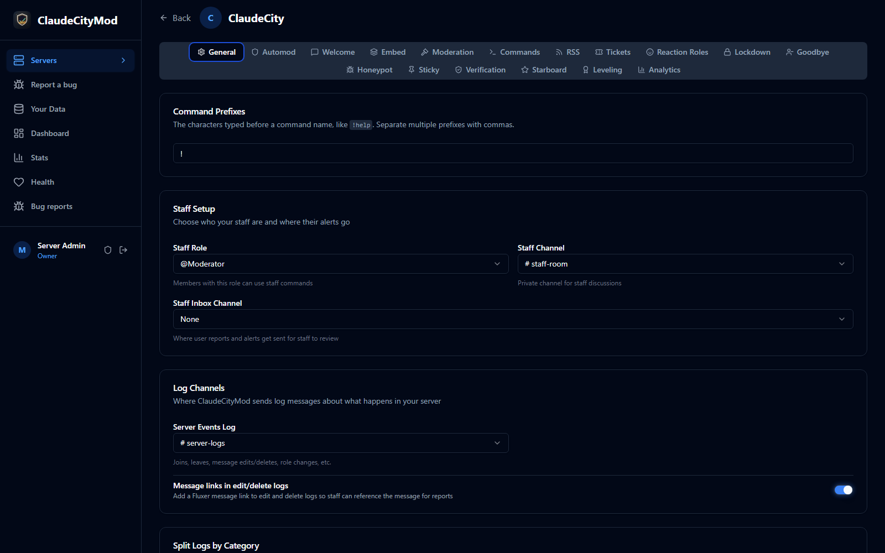
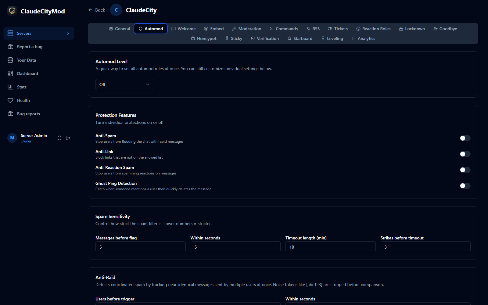
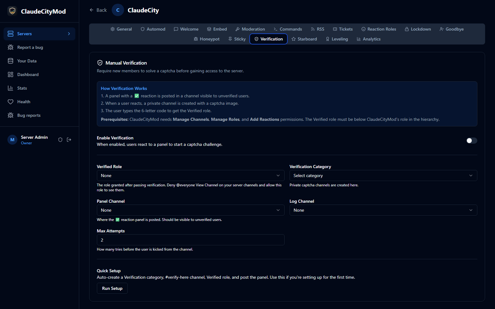
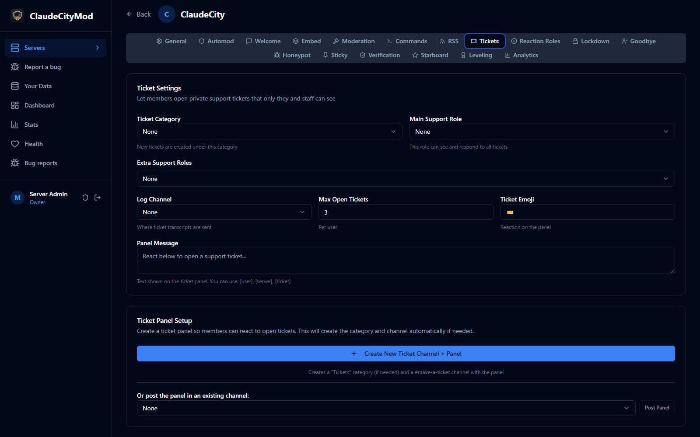

# ClaudeCityMod

**ClaudeCityMod** is a self-hosted verification and auto-moderation bot for
[Fluxer](https://fluxer.app). It includes a full moderation suite and a web
dashboard, and stores everything in MongoDB on your own host.

- **Verification** - captcha panel, verified role, automatic category/channel
  setup, verification logs
- **Auto-moderation** - anti-spam, anti-link, anti-raid, mention/line limits,
  reaction spam, ghost pings, honeypot channels, keyword filters, lockdown
- **Moderation** - ban, kick, warn, timeout, mute, notes, mod logs, mass ban,
  global bans, ban appeals
- **Server tools** - tickets, reaction roles, autorole, welcome/goodbye,
  logging, leveling, starboard, sticky messages, custom commands, RSS feeds
- **Dashboard** - web UI for all settings, analytics, health, and reports

## Dashboard preview

Manage verification, moderation, tickets, and server settings from one private
web dashboard.

| General settings | Auto-moderation |
| --- | --- |
|  |  |
| **Verification** | **Tickets** |
|  |  |

---

## 1. Create the Fluxer application

You need this before any install method.

1. In Fluxer, open **User Settings → Install → Applications**.
2. Create an application named **ClaudeCityMod**.
3. Copy the **bot token** and the **OAuth client ID and client secret**.
4. Add the dashboard redirect URI to the application:
   - local: `http://localhost:4000/auth/callback`
   - server: `https://bot.your-domain.com/auth/callback`
5. Upload `server-icon.png` as the bot avatar.

---

## 2. Install with Docker Compose (recommended)

Works the same on a local machine and on a VPS. You need Docker and the Docker
Compose plugin.

```bash
git clone https://github.com/Sewer2K/FluxerModeration.git
cd FluxerModeration
cp .env.docker.example .env
```

Edit `.env` and set:

```env
TOKEN=your_bot_token
OWNER_ID=your_fluxer_user_id

API_ADMIN_TOKEN=<long random value>
APPEAL_SIGNING_SECRET=<long random value>

DASHBOARD_URL=http://localhost:4000
FLUXER_OAUTH_CLIENT_ID=your_client_id
FLUXER_OAUTH_CLIENT_SECRET=your_client_secret
FLUXER_OAUTH_REDIRECT_URI=http://localhost:4000/auth/callback
```

Generate the two secrets with:

```bash
node -e "console.log(require('crypto').randomBytes(32).toString('hex'))"
```

Start the bot, dashboard, and MongoDB:

```bash
docker compose up -d --build
```

- Dashboard: **http://localhost:4000**
- Logs: `docker compose logs -f claudecitymod`
- Stop: `docker compose down`

The Compose stack runs two containers: `claudecitymod` (bot + API + dashboard)
and `mongo`. MongoDB is not exposed to the host or the internet.

---

## 3. Install locally with Node.js

Requirements: **Node.js 24+**, **pnpm 12+**, and a running **MongoDB**.

```bash
git clone https://github.com/Sewer2K/FluxerModeration.git
cd FluxerModeration
pnpm install --frozen-lockfile
cp .env.example .env
```

Set at least these values in `.env`:

```env
TOKEN=your_bot_token
MONGO_URI=mongodb://127.0.0.1:27017/claudecitymod
OWNER_ID=your_fluxer_user_id

CCM_PROCESS=all
API_ENABLED=true
API_PORT=4000
API_ADMIN_TOKEN=<long random value>
APPEAL_SIGNING_SECRET=<long random value>

DASHBOARD_URL=http://localhost:4000
FLUXER_OAUTH_CLIENT_ID=your_client_id
FLUXER_OAUTH_CLIENT_SECRET=your_client_secret
FLUXER_OAUTH_REDIRECT_URI=http://localhost:4000/auth/callback
```

Build and start:

```bash
pnpm --filter claudecitymod-dashboard build
pnpm build
pnpm start
```

The API serves the built dashboard, so you do not run Vite in production.
Open **http://localhost:4000**.

For development, use `pnpm dev` for the bot and
`pnpm --filter claudecitymod-dashboard dev` for the dashboard (Vite on port
5173, proxying `/api` to port 4000).

---

## 4. Deploy on a VPS

Recommended: Ubuntu/Debian with Docker Compose from section 2.

```bash
# 1. Install Docker
curl -fsSL https://get.docker.com | sh

# 2. Get the code
git clone https://github.com/Sewer2K/FluxerModeration.git
cd FluxerModeration

# 3. Configure
cp .env.docker.example .env
nano .env
```

Use your public address in `.env`:

```env
DASHBOARD_URL=https://bot.your-domain.com
FLUXER_OAUTH_REDIRECT_URI=https://bot.your-domain.com/auth/callback
```

Start the stack:

```bash
docker compose up -d --build
```

### HTTPS with Caddy

Point a DNS A/AAAA record at the VPS, then install Caddy and use:

```caddy
bot.your-domain.com {
    reverse_proxy 127.0.0.1:4000
}
```

Caddy issues and renews the certificate automatically. Add the same HTTPS
redirect URI to the Fluxer application.

### Firewall

Only SSH, HTTP, and HTTPS need to be public:

```bash
ufw allow OpenSSH
ufw allow 80
ufw allow 443
ufw enable
```

Do **not** expose port 4000 or 27017 publicly. `restart: unless-stopped` in the
Compose file starts the bot again after a reboot.

### Updating

```bash
cd FluxerModeration
git pull
docker compose up -d --build
```

---

## 5. Invite the bot and configure your server

Invite the bot using **your** application's client ID:

```text
https://web.fluxer.app/oauth2/authorize?client_id=YOUR_CLIENT_ID&scope=bot&permissions=4504699474930806
```

Then, in your server:

```text
!verify setup
!automod level high
!setlog #mod-logs
```

`!verify setup` creates the verification category, panel channel, and
**Verified** role, then posts the captcha panel. Keep the bot's role above the
Verified role in the server role list.

Useful follow-ups:

```text
!automod status
!verify status
!help
```

Auto-mod levels are `off`, `minimal`, `medium`, and `high`. Fine-tune with
`!automod spam`, `!automod link`, `!automod reactionspam`,
`!automod ghostping`, and `!automod exempt`.

The dashboard at your `DASHBOARD_URL` exposes the same settings plus leveling,
tickets, RSS, starboard, analytics, health, and reports. Log in with your
Fluxer account; server settings require the usual management permissions, and
owner-only pages require `OWNER_ID`.

### Private single-server mode

To keep the bot on one server only, set `ALLOWED_GUILD_ID` in `.env`:

```env
ALLOWED_GUILD_ID=your_server_id
DASHBOARD_ALLOWED_USER_IDS=trusted_user_id,another_user_id
```

With `ALLOWED_GUILD_ID` set:

- The bot leaves every other server it is added to, immediately on join and on
  startup. Commands from other servers are ignored even if a leave fails.
- The dashboard only shows that server.
- Dashboard access is limited to `OWNER_ID`, the IDs in
  `DASHBOARD_ALLOWED_USER_IDS`, and users with **Administrator** or
  **Manage Server** on the allowed server. Everyone else is rejected at login.

`DASHBOARD_ALLOWED_USER_IDS` is optional; leave it empty if the owner and the
server's managers are enough. This is a bot-side lock: for a hard guarantee,
also keep the application private/unlisted in the Fluxer developer settings so
the invite link is not discoverable.

---

## 6. Data, backups, and persistence

With Docker Compose, everything persistent is bind-mounted on the host:

```text
data/
├── mongo/   # MongoDB database
└── bot/     # gateway session, uploads, and bot state
```

Back up and restore:

```bash
docker compose exec -T mongo mongodump --archive --db=claudecitymod > backup.archive
cat backup.archive | docker compose exec -T mongo mongorestore --archive
```

To move hosts, stop the stack and copy the `data/` directory. Rebuilds and
`git pull` do not touch it.

---

## Configuration reference

Only `TOKEN` and `MONGO_URI` are required for the bot. The dashboard/API also
needs `API_ADMIN_TOKEN` and the OAuth values.

| Variable                           | Default                         | Purpose                                            |
| ---------------------------------- | ------------------------------- | -------------------------------------------------- |
| `TOKEN`                            | -                               | Fluxer bot token                                   |
| `MONGO_URI`                        | -                               | MongoDB connection string                          |
| `PREFIX`                           | `!`                             | Default command prefix                             |
| `OWNER_ID`                         | -                               | Your Fluxer user ID for owner-only commands        |
| `ALLOWED_GUILD_ID`                 | -                               | Lock the bot to one server; leaves all others      |
| `DASHBOARD_ALLOWED_USER_IDS`       | -                               | Extra dashboard users, comma separated             |
| `TERMINATION_APPEAL_TAG`           | empty                           | Contact shown in termination notices               |
| `BRANDING_PUBLIC_NAME`             | `ClaudeCityMod`                 | Name shown in messages                             |
| `BRANDING_FULL_NAME`               | `ClaudeCityMod`                 | Longer name for banners                            |
| `BRANDING_DATA_NAME`               | `claudecitymod`                 | Lowercase data/metrics name                        |
| `BRANDING_RSS_USER_AGENT_NAME`     | `ClaudeCityModRSS`              | RSS User-Agent                                     |
| `BRANDING_SOCIALS_USER_AGENT_NAME` | `ClaudeCityMod`                 | Socials User-Agent                                 |
| `BRANDING_DOCS_URL`                | `DASHBOARD_URL`                 | Documentation link                                 |
| `CCM_PROCESS`                      | `all`                           | `bot`, `web`, or `all`                             |
| `API_ENABLED`                      | `false`                         | Enable the dashboard/API                           |
| `API_PORT`                         | `4000`                          | Dashboard/API port                                 |
| `API_ADMIN_TOKEN`                  | -                               | Internal API token; use a strong random value      |
| `APPEAL_SIGNING_SECRET`            | `API_ADMIN_TOKEN`               | Signs ban-appeal links                             |
| `DASHBOARD_URL`                    | `http://localhost:4000`         | Public dashboard origin (CORS/OAuth)               |
| `FLUXER_OAUTH_CLIENT_ID`           | -                               | OAuth application client ID                        |
| `FLUXER_OAUTH_CLIENT_SECRET`       | -                               | OAuth application client secret                    |
| `FLUXER_OAUTH_REDIRECT_URI`        | -                               | Must be `DASHBOARD_URL/auth/callback`              |
| `GATEWAY_SESSION_PATH`             | cwd                             | Gateway session file                               |
| `UPLOADS_DIR`                      | `dashboard/dist/uploads`        | Dashboard upload storage (set to a persistent path) |
| `TOTAL_SHARDS`                     | auto                            | Gateway shard count override                       |
| `RSS_ENABLED`                      | `true`                          | Enable RSS feeds                                   |
| `GLITCHTIP_DSN`                    | -                               | Optional error reporting                           |

See [`.env.example`](.env.example) for the complete list.

---

## Commands

Commands use `!` by default. Run `!help` for the generated list, or
`!help <command>` for details.

| Area            | Examples                                                                 |
| --------------- | ------------------------------------------------------------------------ |
| Verification    | `verify setup`, `verify panel`, `verify role`, `verify status`           |
| Auto-moderation | `automod status`, `automod level`, `automod spam`, `automod link`        |
| Moderation      | `ban`, `kick`, `warn`, `timeout`, `mute`, `note`, `modlogs`, `massban`   |
| Server setup    | `setlog`, `welcome`, `goodbye`, `autorole`, `reactionrole`, `ticket`     |
| Community       | `leveling`, `starboard`, `sticky`, `customcommand`, `rss`, `keywords`    |
| Utility         | `embed`, `status`, `language`, `setprefix`, `mydata`                     |

Owner-only commands (`terminate`, `globalban`, `stats`, `appeal`) require
`OWNER_ID`.

---

## Troubleshooting

- **Bot does not start** - check `TOKEN` and `MONGO_URI`, then read
  `docker compose logs -f claudecitymod`.
- **Dashboard login fails** - the redirect URI in the Fluxer application must
  exactly match `FLUXER_OAUTH_REDIRECT_URI`, including the scheme and port.
- **Dashboard shows the bot offline** - make sure only one process runs the
  gateway, and that `API_ADMIN_TOKEN` matches in split deployments.
- **Verification or role commands fail** - move the bot's role above the roles
  it manages and re-invite with the permissions link above.
- **Mongo connection errors** - wait for the `mongo` health check, or verify
  `MONGO_URI` when using an external database.

## Security notes

- Keep `.env` private. It contains the bot token and OAuth secret.
- Use a long random `API_ADMIN_TOKEN`.
- Do not expose MongoDB publicly.
- Put the dashboard behind HTTPS when it is reachable from the internet.
- The dashboard is optional: set `API_ENABLED=false` and remove the port
  mapping if you only want the bot.

## License

Licensed under **AGPL-3.0** - see [`LICENSE`](LICENSE) for the full text and
copyright notices. If you run a modified version as a network service, you
must offer users the corresponding source code.
